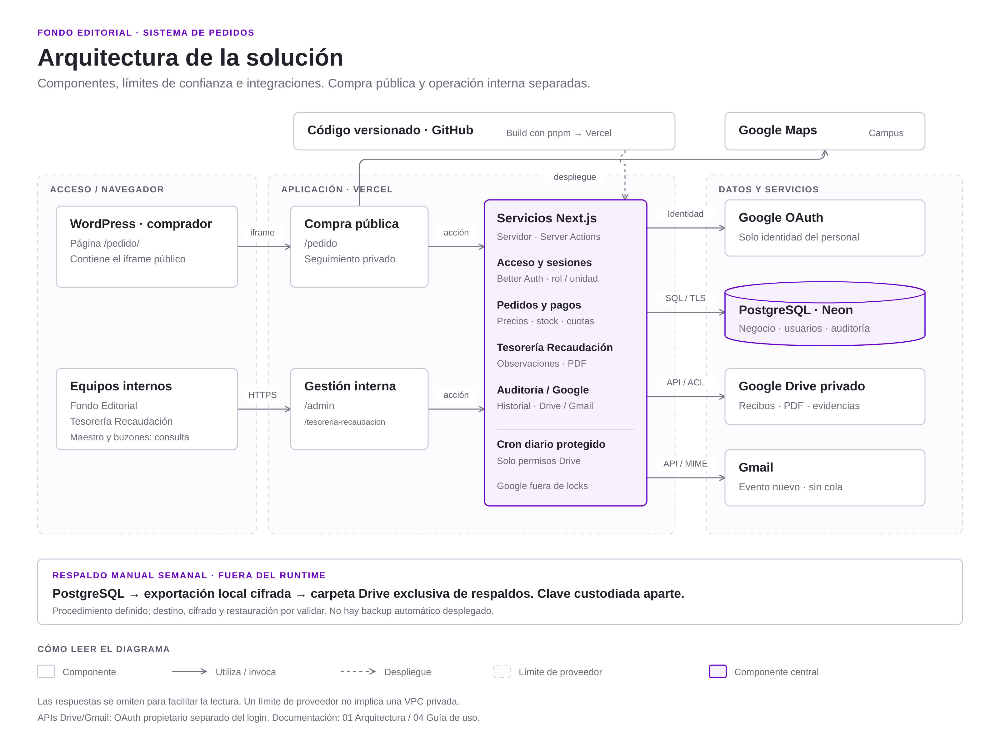
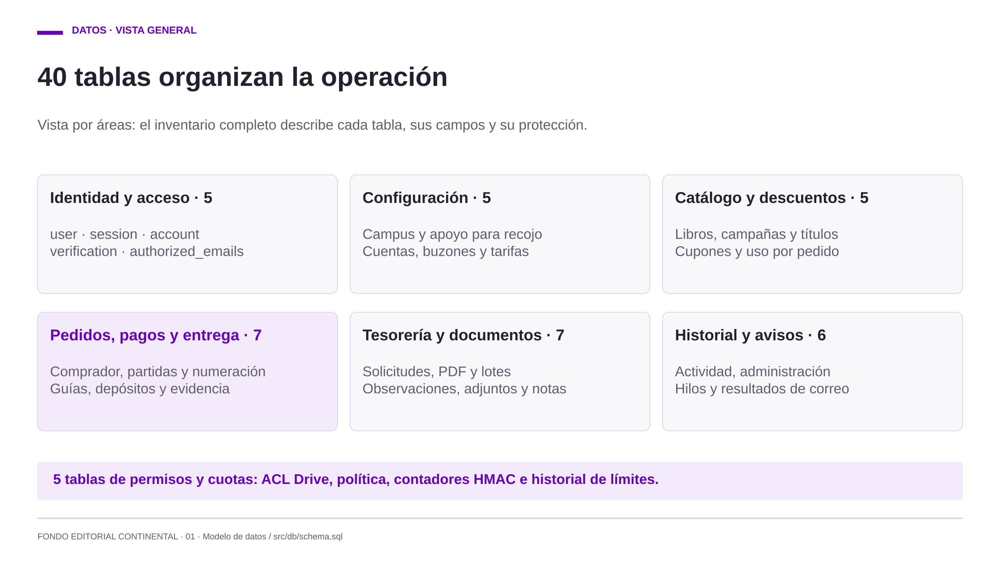
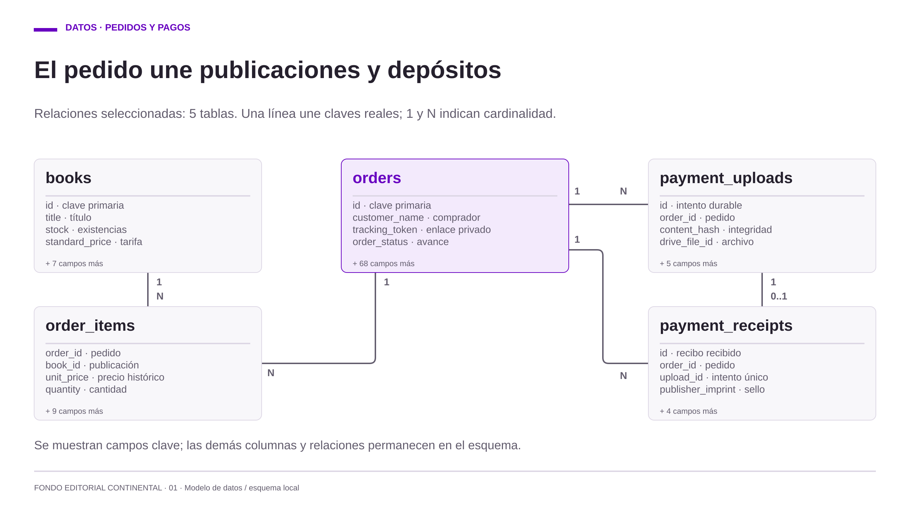
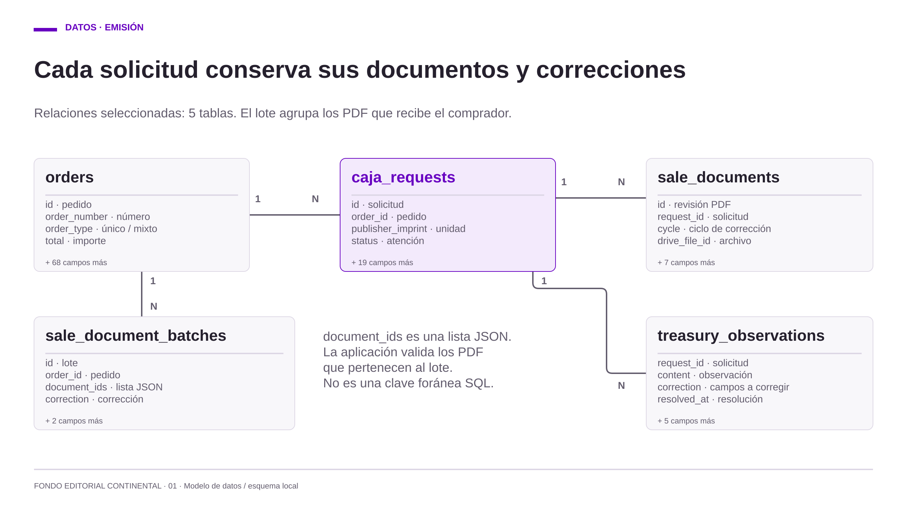
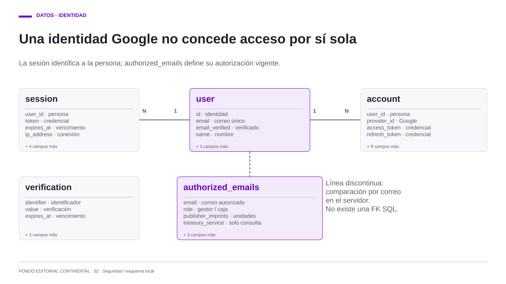

# 01 · Arquitectura y diagramas

[← Inicio](00-inicio.md) · [Siguiente: Seguridad →](02-seguridad.md)

## Solución completa

**Monolito modular Next.js en Vercel**, con PostgreSQL en Neon y servicios Google. WordPress embebe únicamente compra/seguimiento; el personal opera en una pestaña propia con Google OAuth. La plataforma coordina ventas y documentos; no procesa tarjetas, transfiere dinero ni emite directamente documentos tributarios.

Para Word: [PNG de alta resolución](diagramas/01-arquitectura.png). Para modificar o ampliar sin perder calidad: [SVG fuente](diagramas/01-arquitectura.svg). El dibujo representa componentes y relaciones, no una certificación de las consolas ni un orden temporal de ejecución.

## Leyenda común

| Símbolo o término | Cómo leerlo |
| --- | --- |
| Tarjeta/rectángulo | Componente, servicio o punto de acceso; el texto identifica su función |
| Cilindro | Base de datos persistente |
| Contorno punteado con título | Límite de proveedor/ejecución; no significa que exista una red privada o VPC |
| Flecha continua A → B | A utiliza/invoca B; por claridad no se dibuja cada respuesta |
| Flecha punteada | Despliegue fuera del flujo de negocio; no representa polling ni una cola |
| Bloque morado/lila | Componente central del sistema; el color no concede un permiso ni indica un error |
| Franja de respaldo | Procedimiento manual separado, no una tarea automática desplegada |
| Estado en el diagrama de 04 | Situación de un pedido; una flecha muestra una transición permitida, con su condición escrita |
| Punto inicial/final en 04 | Inicio o cierre del proceso; no es una tabla ni la eliminación del registro |

No confundir **arquitectura** (qué componentes existen y cómo se conectan) con **flujo** (en qué orden se atiende un pedido). Los identificadores internos `caja` y `EN_PREPARACION` se presentan como Tesorería Recaudación y Distribución.

## Herramientas de programación

| Capa | Herramientas | Responsabilidad |
| --- | --- | --- |
| Aplicación | Node.js 24, pnpm 11, TypeScript estricto, Next.js 16, React 19 | App Router, renderizado de servidor, Server Actions y rutas de archivos |
| Interfaz | Tailwind, Base UI/shadcn, Inter, FilePond, Sileo, boneyard-js, Recharts | Interacción, cargas, notificaciones, skeletons e indicadores |
| Validación/acceso | Zod, Better Auth, Google OAuth, nanoid | Validación de entradas, sesiones y enlaces privados; permisos propios en BD |
| Datos | Drizzle ORM, PostgreSQL Neon, @neondatabase/serverless | Consultas parametrizadas, esquema, constraints y transacciones |
| Google | googleapis, google-auth-library | OAuth propietario separado para Drive/Gmail |
| Entrega/calidad | Git/GitHub, Vercel, ESLint, TypeScript/Next build | Versionado, despliegue y comprobación estática |

Versiones exactas: `package.json` y `pnpm-lock.yaml`. No hay framework de suites automatizadas por decisión del proyecto. El editor del desarrollador no es una dependencia. Herramientas locales de recursos, como Sharp, no ejecutan generación de imágenes durante un envío de correo.

## Componentes y límites

| Componente | Función y límite de confianza |
| --- | --- |
| Comprador/WordPress | Iframe de compra y seguimiento; token privado por pedido, sin login Google del comprador |
| Módulos internos | Gestores y Tesorería entran directamente a Vercel. Maestro y buzones consultan casos; cuentas personales atienden |
| Acceso y servicios Next.js | Autorización por sesión/rol/unidad/asignación; validación, reglas y efectos desde servidor |
| Neon | HTTP para lecturas; Pool WebSocket por petición para auth/transacciones. No son WebSockets de sincronización de pantallas |
| Drive | Comprobantes, PDF y evidencia privados; permisos nominados por carpeta o archivo según rol |
| Gmail | Avisos nuevos en hilo del comprador y uno interno por solicitud/unidad y aviso separado al apoyo para recojo; sin cola ni recuperación histórica |
| Cron diario | Ruta protegida a las 12:00 UTC, exclusivamente reconciliación de permisos Drive; no envía correos ni hace backups |
| Respaldo | Exportación manual cifrada, fuera de Vercel, a carpeta Drive separada y privada; automatización no implementada |

WordPress usa handshake, `origin/source` exactos y ajuste de altura/scroll. No intercambia PII por postMessage ni comparte la sesión interna. No se relajan cookies/CORS para incrustar administración.

## Datos principales

| Grupo | Tablas y contenido |
| --- | --- |
| Identidad | Tablas Better Auth y `authorized_emails`; la autorización es independiente de que exista identidad OAuth |
| Configuración | `campuses`, `bank_accounts`, `treasury_mailboxes`, `pickup_contacts`, `delivery_rates`, `order_admission_policy` |
| Compra | `books`, `orders`, `order_items`, contador anual, guías y descuentos/cupones |
| Archivos | Intentos durables de carga, recibos, evidencia y PDF de venta; IDs/hash en BD, bytes en Drive |
| Tesorería | Solicitudes, responsable, observaciones/correcciones, notas, documentos y lotes de PDF |
| Auditoría | Actividades de pedido/Tesorería, `management_audit`, `pickup_notifications`, cambios de cuotas y resultado/metadatos de correo |
| Permisos técnicos | Grants Drive y contadores HMAC de admisión, sin IP/correo en claro en estos contadores |

PostgreSQL conserva nombres/precios/cuentas/destino/guía/consentimiento como snapshots. La guía de pago histórica se guarda además como PDF base64 en `payment_guides`; los demás adjuntos operativos mantienen sus bytes en Drive privado. Los importes usan `numeric(12,2)` y cálculo en céntimos. El teléfono, DNI/dirección y tokens OAuth no tienen cifrado propio por campo; el alcance de protección se explica en 02.

<!-- BEGIN:database-map -->

## Base de datos: tablas, información y protección

El esquema inicial local declara **40 tablas**. Esta documentación describe estructura y controles de código; no consulta datos ni acredita la configuración actual de Neon/Google. Fuente: `src/db/schema.ts`, `src/db/auth-schema.ts` y `src/db/schema.sql`.

[Mapa completo en HTML, con cuatro diagramas e inventario](diagramas/02-base-datos.html) · [SVG de la vista general](diagramas/02-base-datos.svg).

### Relaciones principales

Las vistas ER muestran tablas reales y un subconjunto de campos/relaciones. **1:N** significa un registro relacionado con cero o varios; **1:0..1**, con cero o uno. Las líneas continuas corresponden a FK del esquema, sin representar el orden del proceso ni permisos. Una línea discontinua identifica una asociación lógica que valida la aplicación. Cada caja indica cuántos campos adicionales se omiten. Las relaciones no dibujadas siguen existiendo en el esquema.

`caja_requests.draft_document_id` y `finalized_document_id` también referencian `sale_documents.id`; se omiten esas líneas de retorno para facilitar la lectura. `sale_document_batches.document_ids` y `coupons.book_ids` son listas JSON, no claves foráneas: los servicios validan sus referencias.

`authorized_emails.email` se compara con `user.email` desde servidor; no existe una FK entre ambas. `verification` es independiente y no tiene FK a `user`. El esquema estándar incluye `account.password`, pero el login por contraseña local está deshabilitado.

### Cómo se protege la información

| Clave | Alcance del control |
| --- | --- |
| I · Identidad | Solo servidor: sesión vigente, Google verificado y lista autorizada. No publicar tokens ni registros de sesión. El rol SQL autorizado puede leerlos; no hay cifrado propio por campo declarado. |
| C · Configuración | Gestores autorizados mantienen configuración según función; maestro administra accesos/buzones. La compra recibe solo catálogo, tarifas, campus y cuentas necesarios; no el correo del apoyo. |
| O · Pedido | Comprador: token privado y respuesta mínima de su pedido. Gestor personal asignado: decisiones operativas. Stock/numeración/importes protegidos por validación, transacción, locks y versión. |
| T · Tesorería | Sesión y unidades vigentes en servidor; asignación para operar. Notas privadas del equipo. Comprador descarga únicamente PDF finalizado vigente; nunca borradores, evidencia o notas. |
| A · Auditoría | Historial interno y visibilidad por área; proyección pública con allowlist. Sin edición/borrado por UI. Avisos son auditoría, no cola. Append-only a nivel SQL requiere privilegios configurados por TI; no es WORM. |
| S · Control técnico | Gestión desde servidor; cuotas editables por maestro. HMAC no es cifrado ni anonimización absoluta. ACL Drive privadas y revocaciones reconciliables; preservar owners/writers y permisos heredados. |

La separación por rol/unidad/pedido se comprueba en consultas, acciones y transacciones del servidor; **no se presenta como RLS por tabla**. El navegador no recibe credenciales de BD. Restricciones/FK conservan relaciones, pero no sustituyen autorización.

**Límites y responsabilidades de TI:** no hay cifrado propio por campo para datos personales/tokens ni log de cada lectura/descarga. El cifrado en tránsito/reposo, rol SQL mínimo, privilegios append-only, MFA/IAM y ACL efectivas requieren evidencia del proveedor. Hash/HMAC no cifran un DNI o un PDF. El propietario de BD puede alterar registros; el historial no es WORM. Backups manuales deben cifrarse antes de subir y requieren ensayo de restauración.

**Dónde están los archivos:** recibos, PDF de venta, subsanaciones y evidencia guardan metadatos/IDs/hash en PostgreSQL y bytes en Drive privado. La excepción es `payment_guides`: conserva el PDF histórico en `content_base64`. Gmail conserva mensajes aparte. Un dump de BD no incluye los bytes de Drive ni las conversaciones de Gmail.

### Inventario completo por tabla

Los campos siguientes son representativos; la cantidad es el total de columnas del SQL inicial, no el número de registros. La clave de protección remite a la matriz anterior. El inventario no incluye valores ni datos de personas.

#### Identidad y acceso · 5 tablas

| Tabla | Información guardada | Campos de referencia | Protección |
| --- | --- | --- | --- |
| `user` (7 columnas) | Identidad Google del personal: nombre, correo verificado e imagen. | `id`, `name`, `email`, `email_verified` | I |
| `session` (8 columnas) | Sesión, token, vencimiento y metadatos de conexión del personal. | `id`, `user_id`, `token`, `expires_at` | I |
| `account` (13 columnas) | Vinculación OAuth y tokens de identidad; contraseña local deshabilitada. | `user_id`, `provider_id`, `access_token`, `refresh_token` | I |
| `verification` (6 columnas) | Registros de verificación del esquema de Better Auth; no habilita registro abierto. | `identifier`, `value`, `expires_at` | I |
| `authorized_emails` (7 columnas) | Lista de acceso, rol, unidades y condición de buzón de servicio. | `email`, `role`, `publisher_imprints`, `treasury_service` | I |

#### Configuración · 5 tablas

| Tabla | Información guardada | Campos de referencia | Protección |
| --- | --- | --- | --- |
| `campuses` (11 columnas) | Bibliotecas: dirección, ubicación, horario, coordenadas y estado. | `id`, `name`, `library_address`, `pickup_hours` | C |
| `pickup_contacts` (6 columnas) | Contactos de apoyo para recojo; no son usuarios autorizados. | `id`, `name`, `email`, `status` | C |
| `bank_accounts` (10 columnas) | Cuentas receptoras por sello: titular, banco, número y CCI. | `publisher_imprint`, `holder`, `account`, `cci` | C |
| `treasury_mailboxes` (4 columnas) | Buzón institucional de avisos de Tesorería por unidad. | `publisher_imprint`, `email` | C |
| `delivery_rates` (5 columnas) | Tarifa vigente por zona; los pedidos guardan su costo histórico. | `zone`, `price`, `status` | C |

#### Catálogo y descuentos · 5 tablas

| Tabla | Información guardada | Campos de referencia | Protección |
| --- | --- | --- | --- |
| `books` (11 columnas) | Títulos reales, código, autor, sello, precios, stock y estado. | `id`, `title`, `inventory_code`, `stock` | C / O |
| `promotions` (10 columnas) | Campañas, porcentajes por público, alcance y vigencia. | `id`, `name`, `community_percent`, `starts_at` | C / O |
| `promotion_books` (2 columnas) | Relación entre una campaña y los títulos incluidos. | `promotion_id`, `book_id` | C / O |
| `coupons` (13 columnas) | Código, porcentaje, público, títulos, vigencia y límites de uso. | `id`, `code`, `book_ids`, `used_count` | C / O |
| `coupon_redemptions` (4 columnas) | Uso de cupón por pedido y fecha de liberación, si corresponde. | `order_id`, `coupon_id`, `released_at` | C / O |

#### Pedidos, pagos y entrega · 7 tablas

| Tabla | Información guardada | Campos de referencia | Protección |
| --- | --- | --- | --- |
| `orders` (72 columnas) | Comprador/receptor, facturación, destino, importes, estados, responsable, consentimiento y snapshots. | `id`, `order_number`, `customer_document`, `tracking_token`, `order_status` | O |
| `order_items` (13 columnas) | Partidas: título/código/precio histórico, cantidad, descuento e importe. | `order_id`, `book_id`, `book_title`, `unit_price`, `quantity` | O |
| `order_counters` (2 columnas) | Último número por año para numeración transaccional. | `year`, `last_number` | O |
| `payment_guides` (3 columnas) | Guía de pago histórica deduplicada: hash y PDF codificado en base64 dentro de PostgreSQL. | `hash`, `content_base64` | O |
| `payment_uploads` (9 columnas) | Intento durable de carga: hash, ID Drive reservado, formato y tamaño. | `id`, `order_id`, `content_hash`, `drive_file_id` | O |
| `payment_receipts` (8 columnas) | Comprobante recibido por pedido/sello, vinculado al intento y archivo Drive. | `order_id`, `publisher_imprint`, `upload_id`, `drive_file_id` | O |
| `pickup_evidence` (13 columnas) | Metadatos y autor de evidencia opcional de entrega/recojo; imagen privada en Drive. | `order_id`, `actor_user_id`, `drive_file_id`, `content_hash` | O |

#### Tesorería y documentos · 7 tablas

| Tabla | Información guardada | Campos de referencia | Protección |
| --- | --- | --- | --- |
| `caja_requests` (23 columnas) | Solicitud por pedido/sello: estado, ciclo, responsable, borrador, PDF final e hilo interno. | `id`, `order_id`, `publisher_imprint`, `finalized_document_id` | T |
| `sale_documents` (11 columnas) | Revisiones de PDF de venta por solicitud/ciclo, autor, hash y archivo privado. | `id`, `request_id`, `cycle`, `content_hash`, `drive_file_id` | T |
| `sale_document_batches` (6 columnas) | Lote inmutable de documentos vigentes remitidos al comprador. | `id`, `order_id`, `document_ids`, `correction` | T |
| `treasury_observations` (9 columnas) | Observación a Fondo Editorial, corrección solicitada, respuesta y resolución. | `request_id`, `content`, `correction`, `response` | T |
| `treasury_supporting_files` (11 columnas) | Adjuntos privados de subsanación: Drive, hash, tamaño y autor. | `request_id`, `drive_file_id`, `content_hash`, `actor_id` | T |
| `treasury_notes` (6 columnas) | Notas internas del equipo de Tesorería de la unidad, con autor y fecha. | `request_id`, `actor_id`, `content` | T |
| `treasury_activity` (7 columnas) | Historial de eventos de la solicitud y su actor. | `request_id`, `actor_id`, `event`, `detail` | T |

#### Historial y avisos · 6 tablas

| Tabla | Información guardada | Campos de referencia | Protección |
| --- | --- | --- | --- |
| `order_activity` (7 columnas) | Avances y notas internas de Fondo Editorial; salida pública mediante allowlist. | `order_id`, `actor_user_id`, `event_type`, `detail` | A |
| `order_emails` (15 columnas) | Auditoría del correo inicial y referencias/lease del hilo del comprador. | `order_id`, `status`, `gmail_thread_id`, `attempts` | A |
| `order_notifications` (12 columnas) | Evento nuevo, payload, resultado y referencias del aviso al comprador. | `order_id`, `event_type`, `payload`, `status` | A |
| `caja_notifications` (12 columnas) | Auditoría de avisos internos por solicitud/ciclo de Tesorería. | `request_id`, `cycle`, `event_type`, `status` | A |
| `pickup_notifications` (11 columnas) | Destinatario de apoyo y resultado del aviso de recojo. | `order_id`, `contact_id`, `contact_email`, `status` | A |
| `management_audit` (10 columnas) | Cambios de administración, actor, recurso y detalle de campos. | `actor_email`, `event`, `resource`, `details` | A |

#### Permisos y cuotas · 5 tablas

| Tabla | Información guardada | Campos de referencia | Protección |
| --- | --- | --- | --- |
| `drive_reader_grants` (4 columnas) | Seguimiento de permisos nominados y retiros pendientes de carpeta Drive. | `folder_id`, `email`, `permission_id` | S |
| `drive_file_reader_grants` (6 columnas) | Permisos nominados por archivo y solicitud de Tesorería, incluso intentos pendientes. | `drive_file_id`, `email`, `request_id`, `permission_id` | S |
| `order_admission_policy` (9 columnas) | Límites configurables de admisión de pedidos y autor de cambio. | `email_day`, `global_day`, `pending_email`, `updated_by` | S |
| `order_admission_counters` (3 columnas) | Contadores compartidos por ventana, con claves HMAC para correo/IP. | `key`, `window_start`, `count` | S |
| `order_admission_changes` (5 columnas) | Historial de cambios de límites: actor y valores anteriores/nuevos. | `actor_email`, `previous`, `next` | S |

Los controles se detallan y sus límites se mantienen en [Seguridad y accesos](02-seguridad.md). El esquema operativo solo cambia mediante actualización incremental explícita y respaldada, fuera del build.

<!-- END:database-map -->

## Toda la base de datos en un único lienzo

El [diagrama completo con zoom y búsqueda](diagramas/06-base-datos-completa.html) reúne **40 tablas, 404 columnas, 44 claves foráneas y nueve tipos enumerados** en una sola vista, sin dividirla en pantallas. Incluye todas las columnas y conecta los campos de cada FK. Seleccionar una tabla o una columna FK resalta sus relaciones; las demás tablas permanecen visibles. También está disponible el [SVG vectorial completo](diagramas/06-base-datos-completa.svg). Es una vista del SQL inicial local; no contiene registros ni modifica la presentación.

## Consistencia y operación

- Stock, cuotas, numeración anual, partidas y recepción se confirman juntos; un fallo revierte la compra completa. UUID/hash de intento evita duplicar un pedido ya creado.
- Locks ordenados, versión y responsable protegen transiciones; no se reintentan mutaciones ambiguas. Cuotas y pendientes se comparten entre instancias.
- Google queda fuera de locks de pedido/stock. ID de carga/intención ACL durable permite tratar respuestas perdidas sin hacer público el archivo.
- BD y Google no comparten transacción distribuida. Fallos se registran; no se promete exactamente una entrega ante timeout ambiguo de Gmail.
- Sin polling periódico: actualización por acciones, retorno a pestaña limitado y botón manual; pausa durante cargas/borradores.

## Estructura de código

`src/app`: rutas/acciones; `src/components`: UI; `src/lib`: reglas/acceso/integraciones; `src/db`: esquema, SQL inicial, instalador y seed; `src/iframe`: integración WordPress; `src/assets`: PDF e imágenes usadas. Los módulos `server-only` no se importan desde clientes. No hay carpetas de configuración vacías necesarias.
