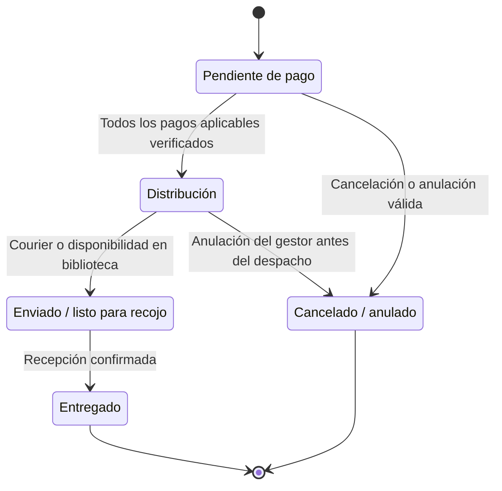

# 04 · Guía de uso y flujo

[← Operación](03-operacion-y-cierre.md) · [Inicio](00-inicio.md)

## Comprador

1. Abrir la [página institucional de pedidos](https://fondoeditorial.continental.edu.pe/pedido/), elegir publicaciones y cantidades.
2. Completar datos de comprador. Para Comunidad Continental, seleccionar sede y usar correo institucional. El precio se aplica según categoría.
3. Elegir recojo o delivery. En recojo consultar biblioteca, ubicación interna y mapa; en delivery completar ubigeo y dirección. Si recibe otra persona, indicar nombre, DNI y teléfono.
4. En confirmación revisar publicaciones, descuento, costo por envío y total. Si requiere factura, completar RUC/razón social y dirección fiscal; puede usar dirección de envío cuando corresponde. El cupón se encuentra en la sección desplegable. Aceptar la política y pulsar **Enviar pedido**.
5. Conservar el enlace privado de seguimiento y la guía recibida. Si el correo falla, el pedido puede estar registrado: conservar el enlace mostrado y no crear otra compra para comprobarlo.
6. Depositar según la guía. Mixto requiere dos depósitos independientes. Cargar comprobante en la sección de cada unidad; la carga se realiza al adjuntar y no requiere botón adicional. Esperar el acuse de recepción antes de cerrar.
7. Consultar Pago, Distribución y Entrega. Un rechazo explica qué debe corregirse. Las boletas/facturas finalizadas se descargan en Pago, incluso después de la entrega.

El enlace permite consultar ese pedido y sus documentos; no compartirlo públicamente ni enviarlo en capturas. Para actualizar usar el icono de refresco cuando no haya una carga/edición en curso. El comprador puede cancelar mientras el pedido esté pendiente y ningún pago verificado; depósitos/devoluciones se coordinan con el área.

Los tiempos estimados de delivery desde despacho son tres días hábiles Lima/Callao y cinco provincia. No son una garantía del courier.

## Gestor de Fondo Editorial

Acceder a [Pedidos](https://modulo-gestor-pedidos.vercel.app/admin/pedidos) mediante Google con correo previamente autorizado. La navegación incluye Pedidos, Reporte, Inventario, Promociones, Cupones, Configuración y guía.

1. Filtrar/ordenar bandeja y pulsar **Ver detalles**. Tomar atención para ser responsable.
2. **1 Atención:** consultar comprador, entrega/receptor, facturación desplegable y compra. El acceso a seguimiento está en el encabezado de responsable. No compartir ese enlace fuera del equipo/titular.
3. **2 Pagos:** abrir recibos en Drive y comprobar unidad e importe. Verificar cada pago o rechazar con motivo claro. Solo verificar si se realizó la validación institucional del depósito.
4. Consultar solicitudes de Tesorería en Pagos. Si hay observación, coordinar con comprador y registrar subsanación/datos o adjuntos necesarios. No usar notas internas de Fondo Editorial para responder una observación.
5. **3 Distribución:** al estar todos los pagos verificados, preparar publicaciones. Registrar courier y despacho para delivery, o disponibilidad de recojo en campus. La acción envía el aviso correspondiente.
6. **4 Entrega:** confirmar recepción; puede adjuntar una imagen opcional por FilePond, esperar su carga y luego confirmar entrega. Guardar evidencia solo cuando aporte y conforme a la política de privacidad.
7. Si un PDF de venta es incorrecto, devolver a Tesorería con motivo en Pagos. Su atención no depende del estado de entrega del libro.

Notas internas e historial se abren desde la cabecera. Notas quedan registradas con autor/fecha; no se editan ni envían por correo. Anulación requiere motivo y solo procede antes del despacho; la devolución del dinero no la ejecuta el sistema.

Inventario permite editar y añadir filas. Mantener código y unidad coherentes; no borrar títulos con historia de compra. Promociones y cupones no se suman. Los reportes contienen agregados operativos, no conciliación contable.

## Operador de Tesorería Recaudación

Acceder a [Solicitudes](https://modulo-gestor-pedidos.vercel.app/tesoreria-recaudacion) con correo personal Google autorizado. Un mismo operador puede tener una o ambas unidades. El buzón de servicio identifica el destino de los correos; no debe utilizarse para atender porque no identifica a una persona responsable.

1. Filtrar por unidad, estado o responsable, ordenar tabla y abrir **Ver detalles**. El número corresponde a solicitud de emisión; no es el código de pedido del comprador.
2. Tomar atención. Si reemplaza a otra persona, registrar motivo de reasignación; queda trazabilidad y aviso al buzón de servicio de la unidad.
3. Revisar badge **Boleta/Factura**, datos de emisión, teléfono, documento/RUC, dirección fiscal cuando aplica, códigos/publicaciones, importes y depósito. El pago fue verificado por Fondo Editorial, pero debe comprobar que los datos permitan emitir su documento.
4. Si hay información incorrecta, registrar una **observación** descriptiva. Fondo Editorial coordina y responde la subsanación; esperar resolución antes de finalizar.
5. Generar la boleta/factura con el sistema tributario habitual. Adjuntar el PDF en el panel derecho. FilePond carga automáticamente; revisar la vista previa. Retirar un borrador requiere que la acción termine correctamente antes de elegir otro.
6. Pulsar **Finalizar solicitud** cuando el PDF y los datos estén correctos. La carga sola no completa la atención. El nombre original del documento se conserva.
7. Si Fondo Editorial devuelve el documento, revisar el motivo, cargar corrección y finalizar nuevamente. El documento anterior permanece en historial cuando corresponde.

Notas internas solo se comparten con el equipo de Tesorería de la unidad; cualquier operador autorizado de ese equipo puede añadir una nota. Para pedir corrección a Fondo Editorial usar observación. Notas e historial están en la cabecera. Los avisos internos llegan únicamente al buzón de servicio, sin CC a operadores. Reporte y Guía están en el menú lateral.

## Maestro y configuración

Ingresar como `distribucionfe@continental.edu.pe` en Configuración. La cuenta maestra consulta pedidos pero no los atiende ni añade notas; para operar se usa un correo personal autorizado. Registrar correos personales para gestores y operadores; seleccionar las unidades de Tesorería y configurar un buzón de servicio por unidad. Los demás gestores consultan accesos pero no pueden añadir/revocar.

Al revocar, se cierran sesiones y liberan atenciones abiertas; el historial cerrado se conserva. El retiro en Drive es una operación externa: consultar al responsable técnico si falla su reconciliación, sin suponer que el cierre de sesión prueba que el permiso de Google ya se retiró.

Mantener cuentas, campus y guías vigentes. Una modificación por interfaz no se copia al seed: informar al responsable técnico si también debe formar parte de futuras instalaciones. No escribir claves bancarias, contraseñas, tokens ni datos personales innecesarios en notas o campos de configuración.

En la pestaña **Seguridad**, el maestro puede ajustar cuotas por correo, conexión, día y pedidos pendientes. Revisar los cinco valores y pulsar **Guardar límites**; el cambio queda auditado y se aplica a pedidos nuevos, sin redeploy. Los demás gestores solo consultan. El maestro dispone además del **Registro de administración**, con los últimos 30 eventos; el historial completo queda en BD. Considerar que varios compradores de un campus pueden compartir IP. Si aparece un conflicto, actualizar antes de volver a guardar.

## Dudas e incidencias

Contactar a Jullisa del Pilar Falla Aguirre (funcional, jfalla@continental.edu.pe) o a Fredy Paolo Romero Espinoza (técnico, fromeror@continental.edu.pe). Reportar pantalla, hora, acción y código seguro si aparece. No adjuntar secretos, documentos de identidad completos, enlaces privados de compradores ni comprobantes sin autorización. No crear pedidos adicionales ni repetir depósitos para diagnosticar un problema.

## Estados del pedido

Leyenda: cajas = estados, flechas = cambios permitidos y su condición. El punto inicial/final marca el proceso, no el borrado del pedido. Véase la [leyenda general](01-arquitectura.md#leyenda-común).

`EN_PREPARACION` es el estado interno presentado como Distribución. El PDF tributario avanza en paralelo: una entrega no exige que Tesorería ya finalice. Observación abierta bloquea finalizar emisión, no la logística; devolución abre un nuevo ciclo con el documento anterior conservado.

## Reglas para la demostración

- Universidad e Instituto tienen cuentas propias. En mixtos son dos depósitos; el flete va solo a Universidad. Recojo S/0, Lima/Callao S/15 y provincia S/25; costos visibles en resumen.
- Comunidad exige campus y correo institucional, pero declarar ese correo no verifica pertenencia mediante OAuth del comprador. Precios/stock/cupones se recalculan en servidor.
- Promociones y cupones no se combinan; gana el mayor ahorro y el empate conserva promociones. El envío no recibe descuento; aplicar cupón en pantalla no reserva su uso.
- Stock insuficiente o datos/precio cambiados abortan sin pedido parcial. Repetir el mismo intento recupera la compra; no crear otro para comprobar si llegó el correo.
- Cancelación conserva historial/documentos y restituye stock una vez. No hay devolución automática de dinero. Desde despacho no se cancela por UI.
- El comprador tiene un hilo; cada unidad de emisión otro, solo a su buzón. Gestores reciben CC de avisos nuevos del comprador; altas de usuarios no reenvían históricos. Mixto recibe un único acuse/aprobación y un lote con ambos PDF cuando corresponda.
- Refresco manual cuando no hay carga/borrador; no hay polling periódico ni botón de reenviar correo.
