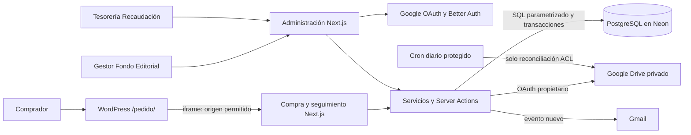
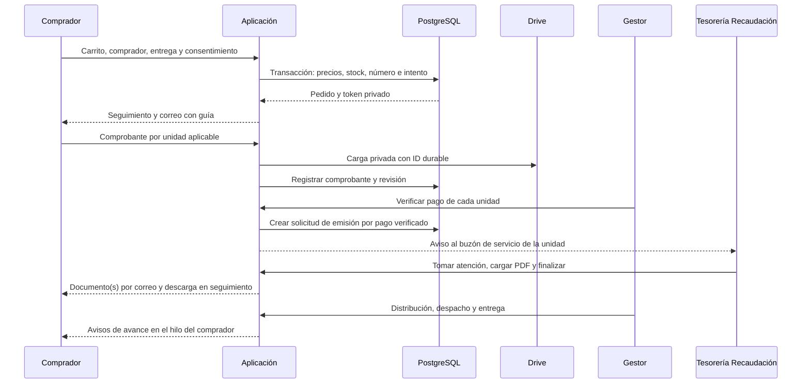

# Arquitectura y tecnologías

## Propósito y alcance

Sistema del Fondo Editorial Continental para solicitar publicaciones, validar depósitos, distribuir pedidos y coordinar la emisión de boletas/facturas con Tesorería Recaudación. No procesa tarjetas, realiza transferencias ni sustituye el sistema contable que emite el documento tributario.

La solución es un **monolito modular** con renderizado de servidor y componentes interactivos, desplegado como aplicación Next.js en Vercel. No son microservicios. WordPress aloja el contenido institucional y embebe exclusivamente la compra y el seguimiento.

## Tecnologías y responsabilidad

Las versiones exactas se fijan en `package.json` y `pnpm-lock.yaml`; no debe usarse esta tabla como inventario de vulnerabilidades.

| Componente | Tecnología | Responsabilidad |
| --- | --- | --- |
| Aplicación | Next.js 16, React 19, TypeScript estricto | App Router, Server Components, Server Actions y endpoints de archivos |
| Interfaz | Tailwind CSS, Base UI/shadcn, Inter | Tema claro, navegación lateral interna y compra por etapas |
| Validación | Zod | Entradas de cliente, acciones y configuración |
| Identidad | Better Auth + Google OAuth | Sesiones y verificación de identidad; autorización propia en BD |
| Persistencia | Drizzle ORM + Neon PostgreSQL | Tipos, consultas parametrizadas, constraints y transacciones |
| Conexión | `@neondatabase/serverless` | HTTP para lecturas; WebSocket por petición para auth/transacciones |
| Archivos | FilePond + Google Drive API | Carga automática y archivos privados con permisos nominados |
| Mensajería | Gmail API + google-auth-library | Avisos inmediatos e hilos separados comprador/tesorería |
| Reportes | shadcn/ui + Recharts | Indicadores agregados sin pedidos ni tokens en los gráficos |
| Estados UI | Sileo, boneyard-js | Notificaciones y skeletons por pantalla |
| Entrega | Vercel + pnpm | Build reproducible; instalación de BD fuera del build |

## Módulos y dependencia

`src/app` define rutas y acciones; `src/lib` concentra servicios, acceso, validación y reglas; `src/db` contiene esquema e instalación inicial; `src/components` presenta datos. Los servicios de Google usan credenciales privadas del servidor. Los módulos de datos marcados `server-only` no se importan desde componentes cliente.

| Módulo | Ubicación principal | Función |
| --- | --- | --- |
| Identidad y permisos | `src/lib/access*`, `auth.ts`, `transaction-access.ts` | Sesión, roles, unidades, maestro y revocación |
| Pedidos | `src/lib/orders` | Cotización, creación idempotente, estados, cancelación, seguimiento y correo |
| Pagos | `src/lib/payments` | Cuentas, guías, validación y carga de recibos |
| Tesorería | `src/lib/caja`, `src/lib/treasury` | Solicitudes, asignación, observaciones, notas, documentos y permisos |
| Inventario/descuentos | `src/lib/admin`, `src/lib/discounts` | Stock, precios, promociones y cupones |
| Integración WP | `src/iframe`, `src/components/iframe` | Handshake, altura y scroll con origen/source validados |

Los nombres internos `caja` y `EN_PREPARACION` son identificadores estables; en la interfaz se usan Tesorería Recaudación y Distribución.

## Flujo de pedido

La emisión tributaria y la logística son independientes: una boleta/factura puede completarse después de entregar las publicaciones. En mixtos, el comprador recibe un único correo con ambos PDF cuando ambos estén finalizados; las solicitudes internas se atienden por separado.

## Consistencia y límites

- Stock, numeración anual, partidas, descuento aplicado y auditoría de recepción se guardan en una transacción. Stock insuficiente aborta todo.
- UUID de intento y hash del contenido evitan duplicar una compra al repetir una solicitud. No constituyen un control de abuso de solicitudes nuevas.
- Bloqueos ordenados, responsable y versión vigente protegen transiciones; no se repiten callbacks de mutación tras timeouts ambiguos.
- Google queda fuera de los locks. Un ID Drive reservado permite reconciliar una carga ambigua; su finalización vuelve a validar estado y autorización.
- BD y Google no comparten una transacción distribuida: pueden existir archivos huérfanos o avisos fallidos. La auditoría conserva el resultado; no hay recuperación posterior de correos.
- Los avisos se intentan durante la acción que crea el evento, después del commit. No hay cola de mensajes ni polling periódico de pantallas. El cron diario solo reconcilia permisos de Drive.

## Despliegue e integración

Producción: `https://modulo-gestor-pedidos.vercel.app`. Página institucional: `https://fondoeditorial.continental.edu.pe/pedido/`. Administración se abre directamente en Vercel, fuera del iframe. Los enlaces de correo públicos usan un fragmento WordPress; el receptor construye la ruta del iframe con origen fijo. No transmite información personal mediante `postMessage`.

El bridge permite altura y desplazamiento tras handshake válido. No comparte cookies de administración con WordPress ni relaja la política de autenticación para incrustarla.
