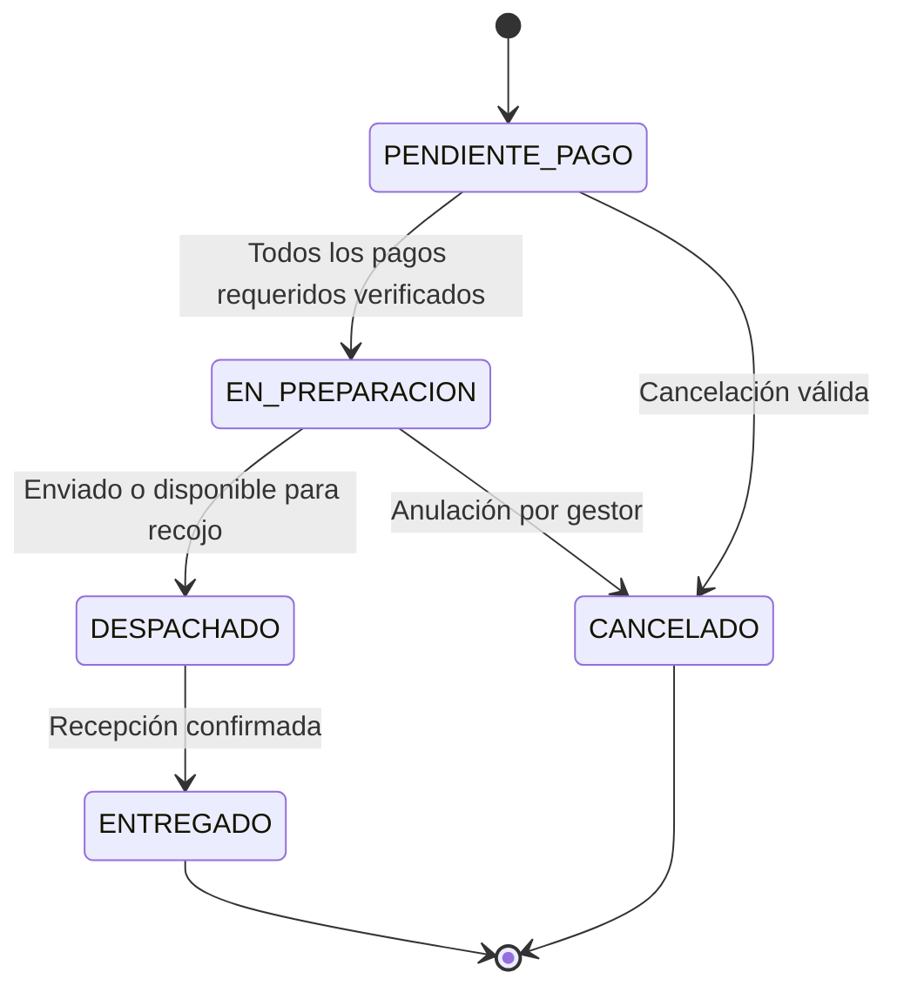

# Casos de uso y reglas operativas

## Actores

Comprador público/comunidad; gestor de Fondo Editorial; maestro de accesos; operador de Tesorería Recaudación por una/ambas unidades; buzón de servicio con consulta. Drive/Gmail y Google OAuth son servicios externos, no usuarios de negocio.

| Caso | Actor y condición | Flujo y resultado | Excepciones relevantes |
| --- | --- | --- | --- |
| Solicitar publicaciones | Comprador con catálogo disponible | Selecciona títulos/cantidades, datos, entrega y facturación, acepta política y envía. Se calculan precios/stock en servidor, número anual y enlace privado. | Sin stock o precio cambiado no se genera pedido parcial; repetir el mismo intento recupera la compra sin duplicarla. |
| Precio comunidad | Comprador comunidad | Indica sede y correo institucional; aplica precio comunitario y descuento vigente compatible. | Dominio no institucional o sede inválida impide continuar como comunidad. No prueba pertenencia mediante correo verificado. |
| Aplicar descuento | Comprador | Promoción vigente por público/título o cupón aplicado en confirmación. Gana mayor ahorro por pedido, sin acumulación; envío sin descuento. | Empate conserva promoción; cupón agotado/vencido se revisa al crear; aplicación en pantalla no reserva un uso. |
| Coordinar entrega | Comprador | Recojo con campus/biblioteca/mapa, o delivery con ubigeo/dirección/receptor. | Lima/Callao S/15; provincia S/25; recojo S/0. Factura exige dirección fiscal; receptor distinto requiere DNI/teléfono. |
| Presentar depósitos | Comprador con enlace | Adjunta PDF/JPG/PNG hasta 3 MiB en cada unidad requerida. Carga automática; acuse y estado en revisión. | Mixto requiere dos depósitos. Rechazo permite sustituir solo el de la unidad observada; conserva el otro. |
| Tomar un pedido | Gestor autorizado | Se autoasigna, queda responsable visible internamente y trazabilidad. | Otra persona debe respetar asignación vigente; acciones sensibles revalidan responsable/versión. |
| Revisar pago | Gestor asignado | Abre comprobante privado y verifica/rechaza por unidad. Verificación crea solicitud de emisión independiente. | Rechazo requiere motivo. Distribución solo se habilita cuando todos los pagos aplicables están verificados. |
| Distribuir y despachar | Gestor asignado con pagos completos | Registra courier/envío o disponibilidad de recojo; el comprador recibe aviso en su hilo. | No se despacha con pagos incompletos. No depende de que Tesorería haya emitido el PDF. |
| Confirmar entrega | Gestor asignado tras despacho | Puede cargar una imagen opcional de evidencia; confirma entrega y avisa al comprador. | La foto no cambia estado por sí misma; no es pública. |
| Cancelar/anular | Comprador o gestor asignado | Comprador cancela pendiente sin pago verificado, motivo opcional. Gestor anula antes de despacho, motivo obligatorio. Restituye stock una sola vez y conserva historial. | Desde despacho no se permite. Depósitos y documentos emitidos se regularizan manualmente; no hay reembolso automático. |
| Consultar emisión | Operador/buzón autorizado | Ve solo solicitudes y partidas/importes de sus unidades, teléfono y datos fiscales necesarios. | No inventario, logística ni notas de Fondo Editorial; buzón de servicio no atiende ni finaliza. |
| Asignar emisión | Operador de la unidad | Toma atención; otro operador puede reasignar/liberar con motivo según situación. Trazabilidad y aviso al buzón al tomar/reasignar. | Solo asignado puede cargar/retirar/finalizar documento; versión y token de asignación invalidan borradores obsoletos. |
| Observar solicitud | Operador asignado | Describe la observación para Fondo Editorial; el gestor responsable coordina y registra subsanación. | Una observación pendiente impide finalizar emisión. Notas internas de Tesorería no sustituyen la observación al gestor. |
| Emitir boleta/factura | Operador asignado | Genera documento en su sistema tributario, adjunta PDF≤3 MiB, revisa vista previa y finaliza. | Subir PDF es borrador; requiere finalizar para comunicarlo. No se emite un documento tributario desde esta aplicación. |
| Recibir PDF de venta | Comprador | Descarga documento finalizado desde Pago y recibe adjunto por correo. | En mixto se envía un único correo con ambos PDF cuando ambos estén listos. |
| Corregir PDF | Gestor asignado y Tesorería | Gestor devuelve con motivo; Tesorería carga nueva versión y finaliza; se conserva anterior y se genera lote vigente. | Puede ocurrir después de entrega. No alterar archivos históricos ni renombrar códigos del PDF. |
| Añadir nota | Personal del equipo correspondiente | Texto append-only con autor y fecha para coordinación. | Notas de Tesorería solo su equipo/unidad; ninguna nota privada llega al comprador ni genera correo. |
| Gestionar configuración | Gestor; accesos solo maestro | Campus/cuentas por interfaz, catálogo en Inventario; maestro registra/revoca personas y buzones. | No convertir automáticamente gestores a Tesorería; identidad Google se crea al primer acceso autorizado. |
| Consultar reportes | Gestor u operador según rol | Período/unidad/responsable y agregados de carga, importes y tiempos según módulo. | Importes no equivalen a ingreso contable; no incluyen un sistema de devoluciones. |

## Estados y comunicación

`EN_PREPARACION` se presenta como Distribución. Cada pago mantiene su propio estado; el no aplicable queda `NO_APLICA` desde creación. La solicitud de emisión tiene un ciclo independiente: pendiente → finalizada, devolución/corrección cuando corresponde, o anulada por cancelación.

El comprador tiene un hilo; cada solicitud/unidad tiene otro, dirigido únicamente a su buzón de servicio. Los gestores reciben CC de los avisos nuevos del comprador según autorización vigente al evento. No se envían históricos al incorporar personas. Un fallo de envío queda registrado y no se recupera en visitas ni cron.
