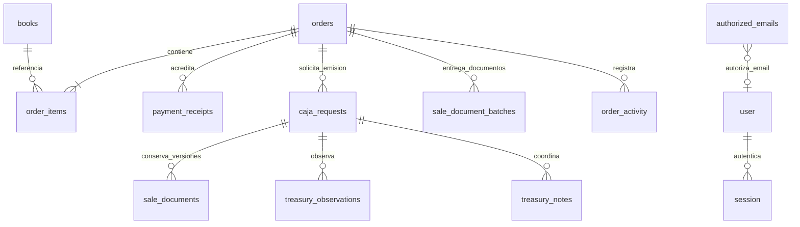

# Datos, almacenamiento y autorización

## Clasificación y finalidad

| Información | Uso | Almacenamiento/copia | Exposición prevista |
| --- | --- | --- | --- |
| Nombre, correo, teléfono, documento | Identificar compra, contactar y emitir documento | Pedido PostgreSQL, contenido necesario de correo/PDF | Gestores; Tesorería autorizada para emisión; titular mediante enlace |
| Dirección de entrega/receptor | Distribución y entrega | Snapshot del pedido, avisos logísticos | Gestores y titular; no wizard logístico de Tesorería |
| RUC, razón social, dirección fiscal | Emisión de factura | Pedido y subsanaciones, correo interno y PDF | Gestores y Tesorería de la unidad |
| Montos, precios, depósitos | Validación y emisión | PostgreSQL, comprobantes Drive, PDFs/correos | Titular y personal autorizado por función/unidad |
| Comprobantes y PDF tributarios | Acreditar depósito y entregar documento | Google Drive privado; metadatos/hash en PostgreSQL; adjuntos de Gmail | Permisos nominados; comprador solo descarga PDF finalizado mediante token |
| Foto de entrega opcional | Evidencia de recepción | Drive privado y metadatos de BD | Administración; no seguimiento público |
| Identidad de operadores | Responsabilidad y trazabilidad | Better Auth, autorizaciones e historial | Personal interno según módulo; no responsable visible al comprador |
| Notas internas | Coordinación de equipos | Tablas de actividad/notas | Gestores para sus notas; Tesorería para sus propias notas |
| Token de seguimiento | Credencial de acceso a un pedido | PostgreSQL, enlace comunicado al comprador | Quien posea el enlace puede consultar y ejecutar acciones públicas permitidas |
| Credenciales OAuth/BD | Operar servicios | Variables privadas; Better Auth conserva tokens de identidad en BD | Solo servidor y administradores técnicos autorizados |

Los datos operativos se almacenan en columnas PostgreSQL legibles para el rol SQL de la aplicación; **no hay cifrado de campo propio ni tokenización de DNI/teléfono**. Un hash de archivo verifica integridad, no cifra el contenido. El cifrado en reposo/tránsito, privilegios del rol y acceso a respaldos deben acreditarse con configuración/evidencia de cada proveedor. No se guardan tarjetas ni credenciales bancarias del comprador.

## Matriz de acceso

| Capacidad | Comprador con enlace | Gestor | Maestro | Operador Tesorería | Buzón servicio Tesorería |
| --- | --- | --- | --- | --- | --- |
| Consultar pedido | Solo el pedido del token | Pedidos operativos | Igual que gestor | Solo solicitud y unidad autorizada | Solo consulta de su unidad |
| Adjuntar depósito | Sello pendiente/rechazado del pedido | Consulta/revisión según asignación | Igual que gestor | Consulta por unidad | Consulta por unidad |
| Revisar pagos y logística | No | Solo responsable asignado | Requiere asignación | No | No |
| Gestionar inventario/descuentos | No | Sí | Sí | No | No |
| Alta/revocación de accesos | No | Consulta | Sí | No | No |
| Tomar solicitud/emitir PDF | No | No | No | Según unidad y responsable | No |
| Observación de emisión | No | Resuelve el responsable del pedido | Igual que gestor | Registra el asignado | No |
| Notas internas de Tesorería | No | No | No por rol gestor | Equipo de la unidad | Solo consulta según vista |
| Descargar documento de venta | Vigente y finalizado | Documentos del pedido | Igual que gestor | Documentos de su solicitud | Consulta de su unidad |

Las comprobaciones se ejecutan en servidor, consultas y transacciones. Ocultar un botón no concede ni revoca permisos. La revocación cierra sesiones y libera atenciones abiertas; el historial cerrado se conserva. Permisos externos heredados o concedidos manualmente en Google requieren gobierno organizacional adicional.

## Modelo de datos lógico

La última relación es **lógica por correo**, no una FK. El maestro se puede autorizar antes de que exista su usuario OAuth.

| Grupo | Tablas principales |
| --- | --- |
| Identidad | `user`, `session`, `account`, `verification`, `authorized_emails` |
| Configuración | `campuses`, `bank_accounts`, `treasury_mailboxes` |
| Comercio | `books`, `orders`, `order_items`, `order_counters`, `payment_guides` |
| Descuentos | `promotions`, `promotion_books`, `coupons`, `coupon_redemptions` |
| Comprobantes y evidencias | `payment_uploads`, `payment_receipts`, `pickup_evidence`, `treasury_supporting_files` |
| Tesorería | `caja_requests`, `sale_documents`, `sale_document_batches`, `treasury_observations`, `treasury_notes`, `treasury_activity` |
| Auditoría y permisos | `order_activity`, `order_emails`, `order_notifications`, `caja_notifications`, `drive_reader_grants`, `drive_file_reader_grants` |

Los nombres y precios de compra, cuentas, guía, consentimiento y destino se conservan como snapshots. Los importes usan `numeric(12,2)` y cálculo en céntimos. Las revisiones de documentos se conservan; cargar una corrección no borra el documento finalizado anterior.

## Minimización y enmascaramiento

Implementado: logs propios con códigos/etapas en lugar de objetos Google/SQL; sin secretos `NEXT_PUBLIC_*`; selección de campos para clientes/reportes; gráficas agregadas; seguimiento sin notas privadas ni identidad del gestor; archivos privados y respuestas no-store/no-referrer.

No existe enmascaramiento general de teléfonos/DNI/direcciones en las pantallas internas: los detalles operativos muestran los campos necesarios para contacto/emisión. TI debe decidir si requiere una política de **ocultar por defecto y revelar según función**, y qué operaciones de revelado deben auditarse. Aplicar una máscara visual no protege un valor que siga enviado al navegador: la minimización debe ocurrir en el DTO del servidor. Los montos y cuentas receptoras necesarios para depositar no se ocultan al comprador.

No incluir datos reales en documentación, capturas, tickets, mensajes de error ni ambientes de prueba. Los logs de infraestructura pueden contener rutas con tokens aunque la aplicación use un logger seguro: revisar redacción, acceso y retención en Vercel/WordPress/analítica.

## Retención y eliminación

**Pendiente de aprobación institucional:** plazo de conservación de pedidos, documentos tributarios, depósitos, evidencias fotográficas, notas, correo y backups; responsable que autoriza eliminación; atención de solicitudes del titular y suspensión por obligaciones de conservación.

La plataforma no tiene una política automática de purga/anonimización. Una copia en Gmail o Drive no desaparece al eliminar una fila de BD. La recuperación de respaldos puede reintroducir autorizaciones revocadas y referencias antiguas; reconciliar accesos antes de reabrir tráfico. El seed restaura configuración inicial, no reemplaza un respaldo.
